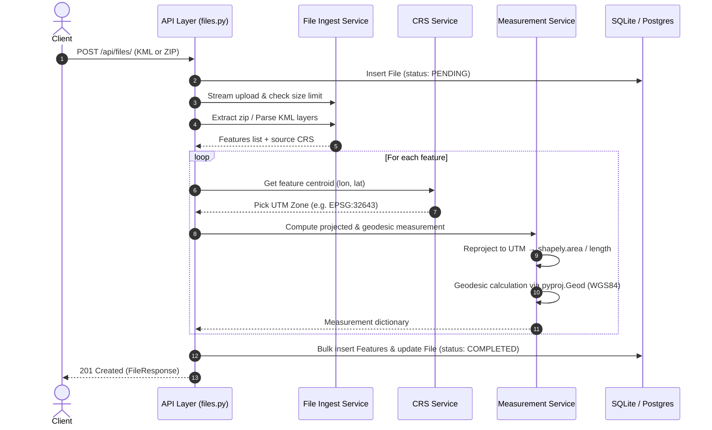

# Geospatial File Measurement API

A production-ready, clean, and robust backend service built with **FastAPI** that accepts geospatial files (**KML** or **zipped Shapefiles**), extracts all features, computes high-precision geographic measurements (area for polygons, length for line strings) using **projected Coordinate Reference Systems (CRS)**, stores results, and exposes them through a structured REST API.

---

## 1. Overview & Features

### Core Capabilities
- **Multi-Format Ingestion**: Supports `.kml` (including multi-layer KML files) and zipped `.shp` Shapefiles (including Shapefiles placed inside nested zip directories).
- **Strict CRS Correctness**:
  - **Never measures in degrees**: Geographic (lon/lat) degrees do not represent uniform physical distances.
  - **Dynamic UTM Projection**: Dynamically determines the appropriate Universal Transverse Mercator (UTM) zone from each feature's centroid (`EPSG:32601`–`32660` for Northern Hemisphere, `EPSG:32701`–`32760` for Southern Hemisphere).
  - Reprojects geometries to metre-based UTM coordinates before computing Euclidean area (`m²`) or length (`m`).
- **Geodesic Cross-Verification**: Computes a parallel ellipsoidal measurement using `pyproj.Geod(ellps="WGS84")` for transparency and accuracy cross-checks.
- **Robust Security & Safety**:
  - **Zip-Slip Protection**: Rejects zip entries containing path traversal (`..` or root paths).
  - **Zip-Bomb Protection**: Strict limits on uncompressed archive size and maximum entry counts.
  - **Streaming Upload Checks**: Enforces the upload size ceiling (default 50 MB) on the fly without loading entire streams into RAM.
  - Property sanitisation prevents NaN, Infinite, and numpy type serialization bugs.
- **Resilient Fault Isolation**: Measures each feature independently; corrupt or unsupported geometry types (e.g., `GeometryCollection`, empty geometries) do not crash the ingestion of valid features in the file.
- **RESTful API**: Fast, typed endpoints with full pagination (`limit` & `offset`) and optional geometry payload toggles.

---

## 2. Setup

### Option A: Local Setup with Python Virtual Environment

**Requirements**: Python 3.11+

```bash
# 1. Clone or navigate to the repository
cd geospatial-measurement-api

# 2. Create and activate a virtual environment
python -m venv venv

# On Linux/macOS:
source venv/bin/activate
# On Windows (PowerShell):
.\venv\Scripts\Activate.ps1

# 3. Install pinned dependencies (pre-compiled binary wheels)
pip install -r requirements.txt

# 4. Configure environment variables (optional)
cp .env.example .env

# 5. Start the development server
uvicorn app.main:app --host 0.0.0.0 --port 8000 --reload
```
The interactive API documentation is available at `http://localhost:8000/docs`.

---

### Option B: Docker & Docker Compose

The Docker setup uses `python:3.12-slim` with standard binary wheels (no system `libgdal-dev` or C++ build tools required).

```bash
# Build and run container in detached mode
docker compose up --build -d

# Check container logs
docker compose logs -f

# Stop container
docker compose down
```
Access the service at `http://localhost:8000` (and `http://localhost:8000/docs`).

---

## 3. Running Tests & Quality Checks

The test suite includes 44 tests covering UTM CRS zone selection, area/length mathematical tolerances, geodesic hole subtraction, zip security, streaming caps, and endpoint status codes.

```bash
# Run pytest test suite
pytest -v

# Run linting with Ruff
ruff check app tests scripts

# Check code formatting with Ruff
ruff format --check app tests scripts
```

---

## 4. REST API Specification & Examples

The repository includes ready-to-use sample files in `samples/`:
- `samples/cubbon_park.kml`: Real-world features located in Bengaluru, India (Polygon, LineString, Point).
- `samples/bengaluru_zones.zip`: Zipped ESRI Shapefile with Polygon boundaries and attribute table in EPSG:4326.

### 1. Health Check
```bash
curl -X GET http://localhost:8000/health
```
**Response (200 OK)**:
```json
{"status": "ok"}
```

---

### 2. Upload Geospatial File (`POST /api/files/`)
Accepts `multipart/form-data` with form field `file`.

#### Example A: Upload KML
```bash
curl -X POST http://localhost:8000/api/files/ \
  -F "file=@samples/cubbon_park.kml"
```
**Response (201 Created)**:
```json
{
  "id": "e939a44f-aeeb-4d2c-8197-be095f8dd3fd",
  "filename": "cubbon_park.kml",
  "feature_count": 3,
  "crs": "EPSG:4326",
  "status": "COMPLETED"
}
```

#### Example B: Upload Zipped Shapefile
```bash
curl -X POST http://localhost:8000/api/files/ \
  -F "file=@samples/bengaluru_zones.zip"
```
**Response (201 Created)**:
```json
{
  "id": "a0d914a4-e555-44a2-b033-ea3fc6353bc8",
  "filename": "bengaluru_zones.zip",
  "feature_count": 2,
  "crs": "EPSG:4326",
  "status": "COMPLETED"
}
```

---

### 3. Get File Metadata (`GET /api/files/{id}/`)
Returns file status, total features, and counts for measured vs unsupported features.

```bash
curl -X GET http://localhost:8000/api/files/e939a44f-aeeb-4d2c-8197-be095f8dd3fd/
```
**Response (200 OK)**:
```json
{
  "id": "e939a44f-aeeb-4d2c-8197-be095f8dd3fd",
  "filename": "cubbon_park.kml",
  "file_type": "kml",
  "feature_count": 3,
  "crs": "EPSG:4326",
  "status": "COMPLETED",
  "created_at": "2026-10-07T11:17:30.148000Z",
  "error_message": null,
  "measured_feature_count": 2,
  "unsupported_feature_count": 0
}
```

---

### 4. Get Measurements (`GET /api/files/{id}/measurements/`)
Returns paginated feature records with calculated measurements.

**Query Parameters**:
- `limit` (int, default: 100, max: 1000): Number of features per page.
- `offset` (int, default: 0): Number of features to skip.
- `include_geometry` (bool, default: true): Whether to include the GeoJSON geometry in the response.

```bash
curl -X GET "http://localhost:8000/api/files/e939a44f-aeeb-4d2c-8197-be095f8dd3fd/measurements/?limit=10&offset=0&include_geometry=false"
```
**Response (200 OK)**:
```json
{
  "file_id": "e939a44f-aeeb-4d2c-8197-be095f8dd3fd",
  "crs": "EPSG:4326",
  "total": 3,
  "limit": 10,
  "offset": 0,
  "features": [
    {
      "feature_index": 0,
      "geometry_type": "Polygon",
      "crs": "EPSG:4326",
      "properties": {
        "name": "Cubbon Park Boundary",
        "description": "Major park in Bengaluru central business district"
      },
      "geometry": null,
      "measurement": {
        "type": "area",
        "value": 300419.25,
        "unit": "square_meters",
        "projected_crs": "EPSG:32643",
        "geodesic_value": 300071.87,
        "method": "projected_utm"
      },
      "supported": true,
      "note": null
    },
    {
      "feature_index": 1,
      "geometry_type": "LineString",
      "crs": "EPSG:4326",
      "properties": {
        "name": "Kasturba Road Promenade",
        "description": "Road running along the edge of Cubbon Park"
      },
      "geometry": null,
      "measurement": {
        "type": "length",
        "value": 775.21,
        "unit": "meters",
        "projected_crs": "EPSG:32643",
        "geodesic_value": 774.76,
        "method": "projected_utm"
      },
      "supported": true,
      "note": null
    },
    {
      "feature_index": 2,
      "geometry_type": "Point",
      "crs": "EPSG:4326",
      "properties": {
        "name": "State Central Library",
        "description": "Heritage building inside Cubbon Park"
      },
      "geometry": null,
      "measurement": null,
      "supported": true,
      "note": "No measurement required for Point geometries"
    }
  ]
}
```

---

## 5. Architecture & Flow

### Application Structure
```
geospatial-measurement-api/
├── app/
│   ├── main.py              # FastAPI application factory, lifespan, root redirect & error handlers
│   ├── config.py            # Pydantic Settings (ENV variables & validation)
│   ├── database.py          # SQLAlchemy 2.0 Engine & session management
│   ├── models.py            # File and Feature ORM models (sqlalchemy.JSON)
│   ├── schemas.py           # Pydantic v2 validation models & OpenAPI schemas
│   ├── api/
│   │   └── files.py         # REST controller: file upload, metadata, and measurements
│   ├── core/
│   │   └── exceptions.py    # Custom domain exceptions & HTTP mappings
│   └── services/
│       ├── file_ingest.py   # Streaming upload, zip extraction, KML/SHP readers
│       ├── crs.py           # Centroid extraction, dynamic UTM zone selection & caching
│       └── measurements.py  # Projected area/length & geodesic calculations
├── tests/
│   ├── conftest.py          # Fixtures, test client, and in-memory test databases
│   ├── test_crs.py          # UTM zone selection & hemisphere tests
│   ├── test_measurements.py # Mathematical accuracy & tolerance tests
│   ├── test_upload.py       # Integration upload tests
│   └── test_errors.py       # Security (zip-slip/size), 4xx responses, and boundary tests
├── samples/                 # Sample KML and zipped Shapefiles
├── scripts/                 # Utility scripts (e.g. generate_samples.py)
├── Dockerfile               # Production container definition (Python 3.12-slim)
├── docker-compose.yml       # Multi-container orchestration
├── requirements.txt         # Pinned production dependencies
└── pyproject.toml           # Project configuration & Ruff rules
```

### File-Processing Flow
1. **Streaming Upload**: File chunks are streamed directly to disk in 64 KB buffers while enforcing `MAX_UPLOAD_SIZE` (50 MB default).
2. **Format Detection & Security Validation**:
   - `.kml`: Read directly; validated against XML structure and parsed for all Placemark folders.
   - `.zip`: Verified for Zip-Slip path traversal (`..` or root paths), Zip-bomb limits (max entries, uncompressed byte ceiling), and inspected for companion files (`.shp`, `.shx`, `.dbf`, `.prj`).
3. **Feature Ingestion & Fault Isolation**: Features are converted to standard GeoJSON structures. Corrupt or unmeasurable geometries (e.g. `GeometryCollection`, empty geometries) are flagged rather than terminating file processing.
4. **Database Persistence**: File record is marked `COMPLETED` and features are bulk inserted with associated metadata.

### Measurement Calculation Flow
1. **Geometry Evaluation**:
   - `Polygon` / `MultiPolygon` → Compute **Area** ($m^2$)
   - `LineString` / `MultiLineString` → Compute **Length** ($m$)
   - `Point` / `MultiPoint` → Valid feature, no measurement required (`measurement: null`)
2. **Projected Euclidean Calculation**: The geometry is reprojected into the chosen metric projected CRS (UTM). Euclidean formulas (`shapely.area` / `shapely.length`) are applied.
3. **Geodesic Cross-Verification**: An independent parallel calculation is executed using the WGS84 ellipsoid via `pyproj.Geod(ellps="WGS84")`. Both numbers are returned in the response for full auditability.

### CRS Handling Strategy
- **Why Degrees Are Never Measured Directly**: Geographic coordinates (`EPSG:4326`) express positions on an oblate spheroid in angular degrees (latitude/longitude). Degrees cannot be converted to physical meters with a single multiplier because $1^\circ$ longitude shrinks from $\approx 111.32\text{ km}$ at the equator to $0\text{ km}$ at the poles by $\cos(\text{latitude})$.
- **Dynamic Centroid-Based UTM Zone Selection**:
  1. The feature centroid is calculated in WGS84 ($[\text{lon}, \text{lat}]$).
  2. UTM Zone is determined: $\text{zone} = \lfloor(\text{lon} + 180)/6\rfloor + 1$.
  3. Hemisphere determines EPSG code: `EPSG:32601`–`32660` (Northern) or `EPSG:32701`–`32760` (Southern).
  4. Geometries are transformed from their native CRS to the specific UTM zone via cached `pyproj.Transformer` instances (`always_xy=True`).



---

## 6. Key Design Decisions & Alternatives

| Decision | Selection | Rationale | Alternatives Considered |
|---|---|---|---|
| **Framework** | **FastAPI** | High-performance ASGI framework with automatic OpenAPI documentation and native Pydantic v2 data validation. | **Django / DRF**: Heavier footprint with built-in ORM overhead not needed for this specialized service. |
| **Processing Paradigm** | **Synchronous Request Processing** | Appropriate for assignment scope with predictable sub-second processing for files up to several thousand features. | **Asynchronous Celery/RQ + Redis**: Recommended for multi-gigabyte files or production high-throughput clusters (see Future Scope). |
| **Database** | **SQLite (Default) via SQLAlchemy 2.0** | Zero-configuration local development while using standard `sqlalchemy.JSON` columns and portable SQL syntax compatible with PostgreSQL. | **Direct PostgreSQL/PostGIS requirement**: Would force external infrastructure setup for local testing and evaluators. |
| **Projection Strategy** | **Centroid-Based UTM (`EPSG:32601..32760`)** | Conformal projection maintaining angle and local scale with less than 0.1% scale distortion near the central meridian. Highly standardized and easily understood. | **Lambert Azimuthal Equal Area (LAEA)**: True equal-area projection, but requires arbitrary custom proj-strings per feature. **Web Mercator (EPSG:3857)**: Metre-based, but distorts area drastically by a factor of $1/\cos^2(\text{lat})$. |
| **KML Driver Strategy** | **Pyogrio list_drivers() with lxml fallback** | Utilizes GDAL's native C++ KML driver if available; seamlessly falls back to pure Python `lxml` parsing if compiled GDAL wheels omit LIBKML. | **FastKML**: Heavier dependency with brittle object models across varying KML schema versions. |
| **Missing `.prj` Handling** | **Reject with HTTP 422 Unprocessable Entity** | Never guess CRS. Guessing EPSG:4326 for an unknown shapefile can lead to severe measurement errors (e.g., degrees squared). | **Assume EPSG:4326 default**: Silent corruption risk. |
| **Invalid Geometries** | **Store & Flag in Note** | Measures the geometry if topological repair is possible, but marks `is_valid: false` in properties/notes so the consumer has full visibility. | **Reject Entire File**: Fails valid features in the same file unnecessarily. |
| **Pagination** | **Limit / Offset with ordered index** | Deterministic ordering using `Index("ix_features_file_id_feature_index")` ensures consistent retrieval without skipping rows. | **Cursor-based**: Adds pagination state complexity without benefit on static uploaded files. |

---

## 7. Known Limitations

1. **Features Crossing Multiple UTM Zones**: A single polygon that spans across several UTM zones (more than 6° longitude) will experience increased scale distortion away from the chosen central meridian.
2. **Antimeridian & Polar Regions**: Features crossing the 180° meridian or sitting directly over the North/South poles (> 84°N or < 80°S) require specialized polar stereographic projections (UPS) rather than standard UTM.
3. **Synchronous File Upload Latency**: Files containing tens of thousands of complex vertices may hold the HTTP connection open for several seconds.
4. **2D Coordinates Only**: Elevation (`Z`) coordinates in 3D KML or Shapefiles are flattened to 2D before surface area/length computation.

---

## 8. Learnings

1. **The Fallacy of Measuring in Geographic Degrees (`EPSG:4326`)**:
   Latitude and longitude are spherical angles, not Cartesian distances. At the equator, $1^\circ$ longitude is $\approx 111,319.5\text{ m}$, whereas at $60^\circ\text{N}$, $1^\circ$ longitude shrinks to $\approx 55,800\text{ m}$. Attempting to calculate Euclidean area directly on geographic coordinates produces nonsensical "square degrees" that cannot be converted to square meters with a static scalar.
2. **The Web Mercator (`EPSG:3857`) Scale Distortion Trap**:
   Web Mercator maps (Google Maps, OpenStreetMap) use planar meters, but the conformal projection introduces extreme areal exaggeration proportional to $1/\cos^2(\text{latitude})$. At Bengaluru ($\approx 13^\circ\text{N}$), raw Web Mercator overestimates area by ~5.6%. At $60^\circ\text{N}$, it overestimates area by 400% (4x). Reprojecting to local UTM or calculating geodesics is mandatory for geographic truth.
3. **WGS84 Ellipsoidal vs Spherical Discrepancies**:
   Due to the Earth's polar flattening ($f \approx 1/298.257223563$), meridian arc length varies between the equator and the poles. Using a spherical assumption produces systematic errors of up to 0.7%, highlighting why `pyproj.Geod(ellps="WGS84")` is essential as an ellipsoidal reference.
4. **Ring Orientation & Hole Subtraction in Pyproj Geod**:
   `pyproj.Geod.geometry_area_perimeter()` computes signed areas based on polygon traversal winding. To guarantee that interior holes are subtracted rather than added, polygons must maintain explicit winding orientations (exterior counter-clockwise, interior holes clockwise). Enforcing `shapely.ops.orient(poly, sign=1.0)` prevents interior holes from artificially inflating the total area.
5. **GDAL Wheel Distribution & Driver Isolation**:
   Modern binary wheels for `pyogrio` bundle complete GDAL C-libraries without requiring system-level `apt-get install libgdal-dev`. However, GDAL builds frequently vary in driver compilation (e.g. omitting `LIBKML`). Implementing a dynamic driver check (`pyogrio.list_drivers()`) paired with a robust `lxml` parser ensures zero-dependency resilience across environments.
6. **Defensive Archive Ingestion**:
   Handling compressed archives in web services requires active defense against Zip-Slip path traversal attacks (`..` or root absolute paths) and Zip-bomb decompression exhaustion through upfront header inspection and byte limits.

---

## 9. Future Scope

1. **Asynchronous Task Queue (Celery + Redis)**:
   For massive spatial files containing tens of thousands of complex polygons, transition `POST /api/files/` to return `202 Accepted` with a job ID, delegating processing to Celery workers and notifying clients via WebSockets or polling.
2. **Native Spatial Database (PostgreSQL + PostGIS)**:
   Replace SQLite with PostgreSQL and PostGIS, storing geometries as native `GEOGRAPHY` or `GEOMETRY` types and using GiST spatial indexing with database-level `ST_Area` and `ST_Length`.
3. **Automated Topology Repair**:
   Integrate `shapely.make_valid` on ingest to automatically repair invalid, self-intersecting, or non-simple geometries (e.g. bowtie polygons) while logging the repair operations.
4. **Global Equal-Area & Polar Projections**:
   Add support for continental or global features that span multiple UTM zones by dynamically selecting Lambert Azimuthal Equal Area (LAEA) or Albers Equal Area, and Universal Polar Stereographic (UPS) for polar geometries ($>84^\circ\text{N}$ / $<80^\circ\text{S}$).
5. **Export & Format Conversion Endpoints**:
   Provide `GET /api/files/{id}/export?format={geojson|shapefile|geopackage}` to allow users to download their processed datasets with computed measurement attributes appended to the feature schema.
6. **Direct Cloud Object Storage Integration**:
   Support streaming file uploads directly to AWS S3, Google Cloud Storage, or Azure Blob Storage with pre-signed URLs to reduce web server disk and memory loads.

